# GitHub Activity Painter

**Display a logo, some text or pixel art in your GitHub contribution graph.**
Design your picture in a local web page, let the tool create the commits, push — voilà.

## 🤖 Ask Claude Code

Don't want to do it by hand? Paste this into [Claude Code](https://claude.com/claude-code), fill in the first three
lines, and it does everything for you (it asks before pushing):

```text
Paint my GitHub contribution graph with https://github.com/lkorczowski/github-activity-painting

What to paint: <some text, the path to a logo, or "start the interface, I'll draw it myself">
Where: <"community wall" (shared picture, via a pull request) or "my own copy" (can be redone any time)>
Darkest green = <e.g. 10> commits per day (or "look at my profile and suggest a value")

Steps:
1. Read that repository's README first and follow it.
2. Community wall: fork it and clone my fork (gh repo fork lkorczowski/github-activity-painting --clone),
   then run `python3 paint.py community --no-browser`.
   My own copy: gh repo create github-activity-painting --public --clone
   --template lkorczowski/github-activity-painting, and work on its default branch.
3. Author the commits with my GitHub no-reply email (<id>+<login>@users.noreply.github.com, from `gh api user`),
   otherwise they won't count and the community wall rejects them.
4. If I gave text or a logo, build the design (python3 paint.py serve; or write a design JSON as described in
   the README and use `python3 paint.py apply`), centre it in the graph and show me a preview before creating
   the commits. Otherwise start the interface and give me its URL.
5. Create the commits and show me `python3 paint.py status`. Ask me before pushing.
6. Community wall: push the `my-painting` branch to my fork, open a pull request to
   lkorczowski/github-activity-painting with gh pr create, then check the bot's result and fix what it reports.
   My own copy: git push --force-with-lease.
7. Tell me when it should show up on my profile.
```

Two ways to play:

| | 🎨 **Community wall** | 🔒 **Your own copy** |
| --- | --- | --- |
| How | [Fork, paint, open a pull request](#-the-community-wall) — it is checked and merged automatically | [“Use this template”, paint, push](#-step-by-step--your-own-copy) |
| Your profile | ✅ shows your painting | ✅ shows your painting |
| Collaborative | ✅ everybody's painting adds up on [the wall](#-the-community-wall) | — |
| Repaint / delete later | Only before it is merged | Any time |

## Features

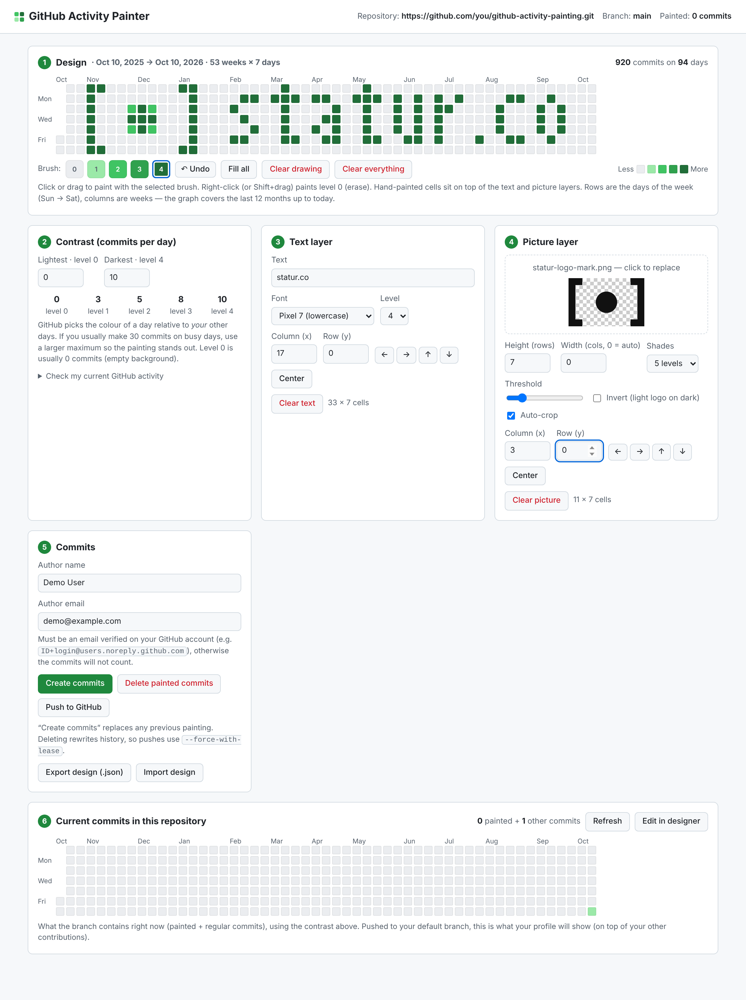

- 🖼️ **Picture → pixels**: import a logo (PNG, JPG, SVG…), it is cropped, scaled and turned into the 5 GitHub shades.
- 🔤 **Text**: two built-in pixel fonts (CAPITALS 3×5 and lowercase 7 rows) or any font installed on your computer.
- 🖌️ **Hand painting**: click / drag with 5 brush levels, erase, undo, fill.
- 🎚️ **Contrast**: choose how many commits the lightest and the darkest green represent.
- 🧾 **Repository view**: see what is already committed, edit it, delete it.
- 🧹 **Reversible**: painted commits are empty and tagged, so they can be deleted at any time without touching your files.
- 🐍 **No dependency**: Python 3.8+ and git. Nothing to install.

## 🎨 The community wall

Every painting merged here adds up into one collaborative picture (each painter's commits still show on their own
profile):


**Join in:**

1. **Fork** this repository (button at the top right), then clone *your fork*:
   ```bash
   git clone https://github.com/<you>/github-activity-painting.git
   cd github-activity-painting
   python3 paint.py community
   ```
   This adds this repository as `upstream`, creates a `my-painting` branch on top of the current wall and opens the
   interface in community mode: the wall is shown, your own cells are outlined in blue.
2. Design (see [step 4](#4-design)), keep the suggested author email (your GitHub no-reply address) and click
   **Create commits**. You can repaint as many times as you want.
3. Click **Push & open pull request**, then **Create pull request** on GitHub.
4. A bot checks it and merges it within a minute. Your painting appears on your profile and on the wall. 🎉

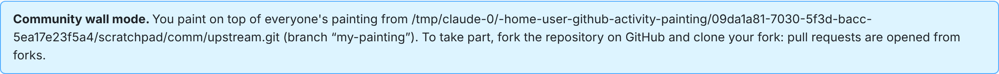
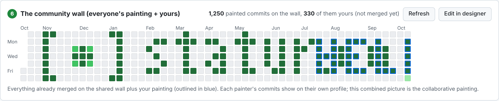

> Why does this count on your profile when a fork normally doesn't? Once merged, your commits live in this
> (non-fork) repository's default branch, and you opened a pull request here — that is what GitHub requires.

### What the bot accepts (and why it is safe)

The pull request is merged automatically **only if every commit**:

- is **empty** — it changes no file at all, so **no code or data can be added** to the repository;
- has exactly the message written by `paint.py` (`Paint YYYY-MM-DD (i/n)` + `Activity-Painter: true`);
- is authored with **your own** GitHub no-reply email (`ID+login@users.noreply.github.com`), so nobody can paint on
  someone else's profile;
- is dated within the last year, with at most 100 commits per day and 5,000 per pull request.

Otherwise the bot comments with what is wrong and the pull request waits for a human. The check
([`.github/workflows/community-painting.yml`](.github/workflows/community-painting.yml)) never checks out or runs
anything from the pull request: it reads the commits as plain git data with the `paint.py` of the default branch.
Pull requests that change the tool itself are welcome too — they are reviewed by hand like in any project.

> Merged paintings are permanent: think before you paint, and keep it friendly. 🙂

---

---

## How the graph works (and the size of the grid)

The contribution graph is **7 rows × 53 columns**:

- each **row is a day of the week** (Sunday at the top, Saturday at the bottom) — not a day of the month;
- each **column is a week**; the graph covers the last 12 months up to today, so it is 53 weeks wide
  (occasionally 54 when the year wraps around a leap day). The first and last columns are usually incomplete:
  the cells before “one year ago” and after “today” are not shown.

Each day gets one of **5 levels** (0 = grey, 4 = darkest green). GitHub picks the level of a day *relative to your
other days*: someone who usually makes 100 commits a day will not see 10 commits the same way as someone who never
commits. That is why the tool lets you set the **number of commits for the lightest (level 0) and darkest (level 4)
shades**; levels 1–3 are spread evenly in between. With the default 0 → 10: `0, 3, 5, 8, 10` commits.

> The painting is tied to real dates, so it slowly scrolls to the left as weeks go by and leaves the graph after a year.
> Just repaint to move it back.

---

## 🔒 Step by step — your own copy

Steps 3 to 5 are the same in community mode.

### 1. Get your own copy

> ⚠️ **GitHub does not count commits made in a fork** in your contribution graph
> ([docs](https://docs.github.com/en/account-and-profile/setting-up-and-managing-your-github-profile/managing-contribution-graphs-on-your-profile/why-are-my-contributions-not-showing-up-on-my-profile))
> — that's why the community wall goes through pull requests. For a private painting, use one of these instead:

- **Recommended — “Use this template”** → *Create a new repository* (public, or private with
  *“Private contributions”* enabled on your profile). You get a standalone copy without the example painting.
- **Or duplicate it manually**: create an empty repository on GitHub, then
  ```bash
  git clone https://github.com/lkorczowski/github-activity-painting.git
  cd github-activity-painting
  git remote set-url origin https://github.com/<you>/<your-new-repo>.git
  ```
- A **fork** you push to directly works only if you ask GitHub Support to detach it (*“Leave fork network”*).
- After “Use this template”, you can delete `.github/workflows/` from your copy: the community bot is only useful here.

<!-- SCREENSHOT PLACEHOLDER: docs/screenshots/00-use-this-template.png
     The GitHub page of the repository with the green “Use this template” button highlighted
     and the “Create a new repository” form (owner, name, public/private). -->
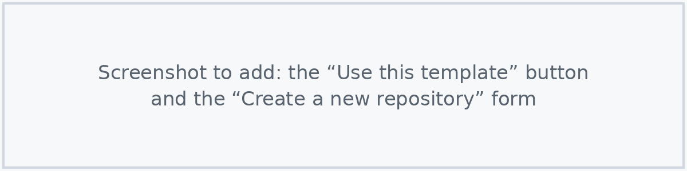

### 2. Download it locally

```bash
git clone https://github.com/<you>/<your-repo>.git
cd <your-repo>
git switch main          # paint on your DEFAULT branch: GitHub only counts commits there
```

### 3. Start the interface

```bash
python3 paint.py         # on Windows: py paint.py
```

It starts a small local server (only reachable from your computer) and opens
`http://127.0.0.1:8765/github-activity-painter.html` in your browser.
Options: `--port 9000`, `--no-browser`, `--repo path/to/another/repo`. Stop it with `Ctrl+C`.

<!-- SCREENSHOT PLACEHOLDER: docs/screenshots/02-terminal.png
     A terminal showing `python3 paint.py` and the printed URL. -->
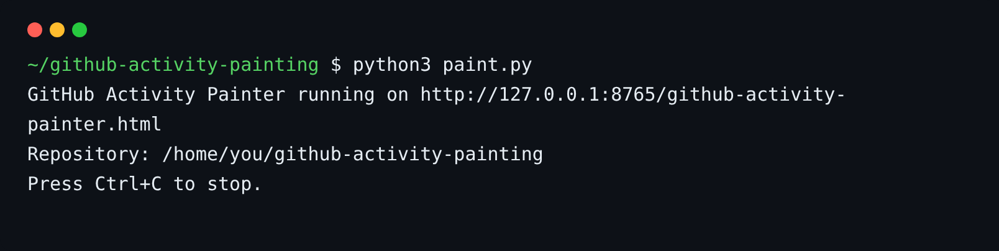

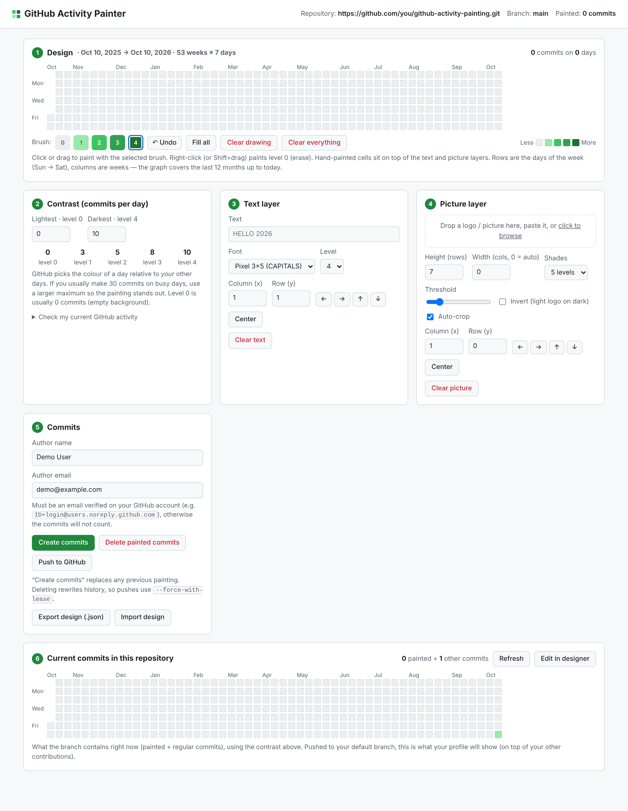

The header shows the repository, the branch and how many painted commits it already contains.
A yellow banner warns you if you are not on the default branch.

### 4. Design

All layers are combined: hand-painted cells win, otherwise the darkest of the text and picture layers.

**Text layer (3).** Type your text, pick a font and a level (shade), and place it with *Column (x)* / *Row (y)*,
the arrow buttons or *Center*. *Pixel 3×5* fits ~13 characters, *Pixel 7 (lowercase)* ~13 lowercase letters,
*Any font* rasterises a font installed on your computer (better for big, bold fonts).

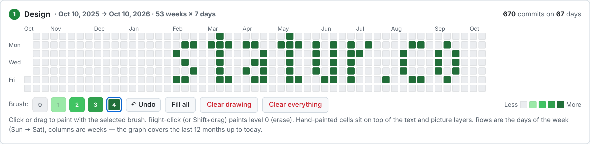

**Picture layer (4).** Drop a picture on the box, paste it (Ctrl+V) or click to browse.
- *Height* — rows used (1–7); the width follows the aspect ratio unless you force it.
- *Shades* — *5 levels* keeps the grey levels (nice for round shapes), *1 colour* gives a crisp silhouette.
- *Threshold* — how dark a pixel must be to be painted. *Invert* for a light logo on a dark background.
- *Auto-crop* removes the empty/white margins. Transparent pixels are never painted.
- *Clear picture* removes the layer.

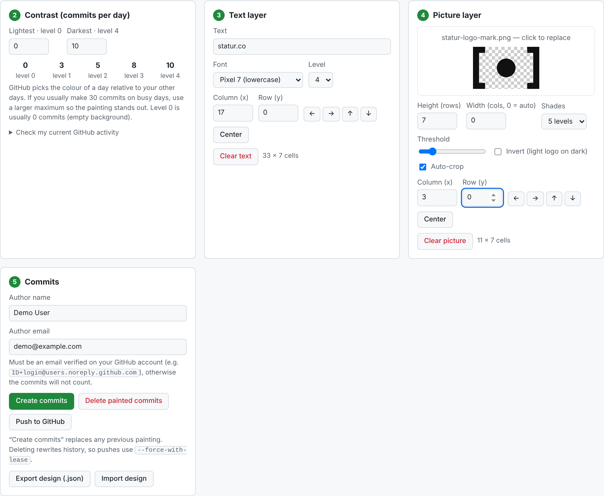

**Hand painting (1).** Pick a brush level (or press `0`–`4`) and click / drag on the graph. Right-click or
Shift+drag erases. `Ctrl+Z` undoes. *Fill all* paints every day, *Clear drawing* removes hand-painted cells,
*Clear everything* resets all layers. Hover any cell to see its date and number of commits.

**Contrast (2).** Set the commits per day of the lightest and darkest shades. The summary at the top right
tells you how many commits will be created. *Check my current GitHub activity* loads your public profile graph and
suggests a maximum (your busiest day + 20 %), so the painting stays visible above your real activity.

Your work is saved in the browser automatically. *Export design* saves a `.json` you can share or reuse
(see [`designs/statur.co.json`](designs/statur.co.json)).

### 5. Create the commits

Fill in the **author name and email** — the email **must be verified on your GitHub account**, otherwise the
commits will not count. Your private address is fine, or use the no-reply one shown in
[GitHub → Settings → Emails](https://github.com/settings/emails) (`ID+login@users.noreply.github.com`).

Click **Create commits**. The tool:

1. removes the previous painting, if any (so you can iterate as much as you like),
2. creates `N` empty commits on each day (dated at noon UTC, so the day is the same in every time zone),
   in a fraction of a second thanks to `git fast-import`.

The **Current commits in this repository** graph (6) is refreshed and should match your design.

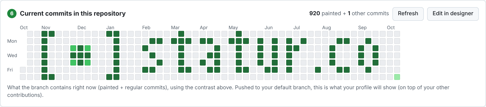

- **Edit in designer** copies the painting of the repository back into the editor, to modify it.
- **Delete painted commits** removes them all — your own commits and files are kept.

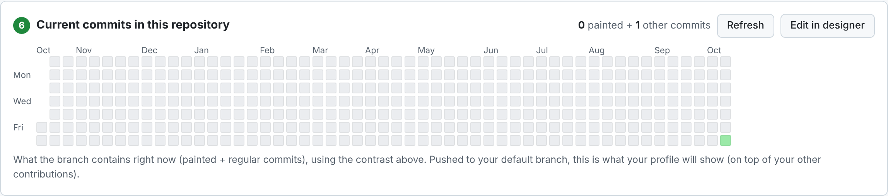

### 6. Push — voilà

Click **Push to GitHub**, or in a terminal:

```bash
git push --force-with-lease
```

`--force-with-lease` is needed whenever you replaced or deleted a painting (it rewrites the painted part of the
history); it refuses to overwrite commits you don't have locally. Your profile may take a few minutes to refresh.

<!-- SCREENSHOT PLACEHOLDER: docs/screenshots/09-github-profile.png
     The final result on the GitHub profile page (https://github.com/<you>), showing the painted
     contribution graph. -->
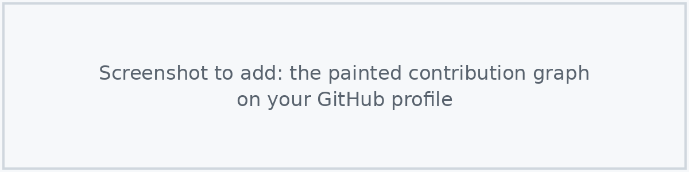

---

## Command line

Everything the interface does with commits is also available without a browser:

```bash
python3 paint.py status                        # painted commits per day
python3 paint.py apply designs/statur.co.json  # paint an exported design (replaces the current painting)
python3 paint.py apply design.json --max 30    # ... with another contrast
python3 paint.py apply design.json --name "Jane" --email "jane@example.com"
python3 paint.py clear                         # delete every painted commit
python3 paint.py community                     # community mode (fork + pull request), see above
python3 paint.py wall docs/wall.svg            # draw every painted commit of the branch as an SVG
python3 paint.py validate --base origin/main --head <sha> --login <you> --user-id <id>   # the bot's check
```

The author defaults to `git config user.name` / `user.email` (or the `PAINTER_NAME` / `PAINTER_EMAIL` environment variables).

### Design file format

```json
{
  "app": "github-activity-painter", "version": 1,
  "range":    { "start": "2025-10-10", "end": "2026-10-10" },
  "contrast": { "min": 0, "max": 10 },
  "levels":   { "2025-10-26": 4, "2025-12-02": 2 },
  "counts":   { "2025-10-26": 10, "2025-12-02": 5 }
}
```

`levels` (0–4 per date) are converted with `contrast`; if `counts` is present it is used as-is (it is ignored when
you pass `--min`/`--max`). With `min > 0`, every day of `range` gets at least `min` commits.

---

## Troubleshooting

| Problem | Fix |
| --- | --- |
| Nothing shows on my profile | Commits must be on the **default branch**, of a repository that is **not a fork**, with an author email **verified on your account**. Private repo? Enable *Private contributions* in your profile settings. Wait a few minutes. |
| The painting looks washed out | You have busy days elsewhere: increase the *darkest* number of commits. |
| `push` is rejected | Use `git push --force-with-lease` (the painting rewrites history). If someone else pushed, pull first. |
| “HEAD is detached” | `git switch main` (or your default branch). |
| The page says “Not connected” | Open the URL printed by `python3 paint.py`, not the HTML file directly. You can still design and export a `.json`, then use `paint.py apply`. |
| My community pull request was not merged | Read the bot's comment on the pull request: usually the author email. Run `python3 paint.py community`, keep the suggested no-reply email, **Create commits** and push again. |
| I want to remove everything | **Delete painted commits** (or `python3 paint.py clear`), then `git push --force-with-lease`. |

## How it works

- Painted commits are **empty** (same tree as their parent) and carry the trailer `Activity-Painter: true`.
- **Delete** rebuilds the branch without them: other commits keep their content, author, dates and message
  (only their parent changes, and any GPG signature is dropped). A commit that has the trailer but changes files is
  never removed.
- `--base <ref>` (set automatically in community mode) protects every commit reachable from `<ref>`:
  only the painting on top of it can be replaced or deleted.
- The wall picture is redrawn by [`.github/workflows/wall.yml`](.github/workflows/wall.yml) after each merge
  and every week (the graph scrolls with time).
- Nothing leaves your computer except when you push. The server only listens on `127.0.0.1` and rejects
  cross-site requests.

## Development

```bash
python3 -m unittest discover tests   # back-end tests (temporary git repositories)
```

The interface is a single self-contained file, [`github-activity-painter.html`](github-activity-painter.html)
(no external scripts, light and dark themes); the server and git logic live in [`paint.py`](paint.py).

Inspired by [github_painter](https://github.com/mattrltrent/github_painter) and
[github-painter.vercel.app](https://github-painter.vercel.app/).
